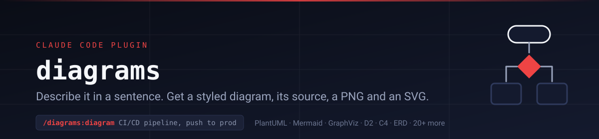
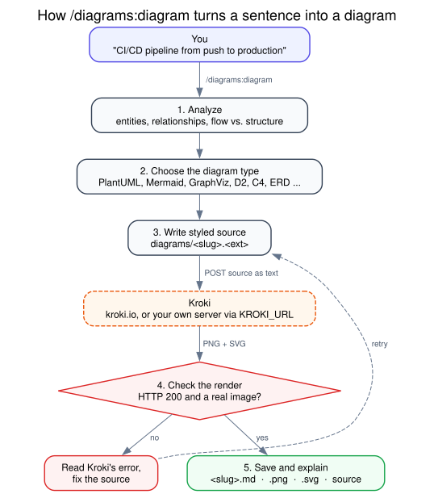
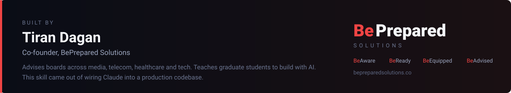

<p align="center">
  <em>A Claude Code plugin by <a href="https://bepreparedsolutions.co">Tiran Dagan</a> —
  because describing a diagram should take less time than drawing one.</em>
</p>

# Diagrams

**The problem.** Drawing a diagram by hand means a drawing tool, a blank canvas and
an hour of nudging boxes, and the result is a picture nobody can update.
Asking a chatbot for "a diagram" usually gets you a block of Mermaid or PlantUML
you still have to render somewhere, in whatever diagram type it picked first,
laid out wider than your screen.

**The fix.** Describe what you want in a sentence, or point Claude at your code or
docs. The `diagram` skill:

| Step | What happens |
|---|---|
| **Analyze** | Finds the entities, relationships and whether it's a flow, a structure, a hierarchy or a network |
| **Choose** | Picks the right diagram type from 20+: a sequence diagram for API calls, C4 for architecture, an ERD for a schema, a Gantt chart for a plan |
| **Write** | Writes clean, styled source: a title, labels on every arrow, grouping, colour that means something, top-to-bottom so it fits your screen |
| **Render** | Sends the source to [Kroki](https://kroki.io/) and gets back a PNG and an SVG |
| **Check** | Confirms each render succeeded; if Kroki reports an error, reads it, fixes the source and renders again |
| **Save** | Writes four files to `diagrams/` in your project: the PNG, the SVG, the editable source and a short note on the design choices |

## Install

**From Anthropic's plugin directory:** open the
[Diagrams listing](https://claude.ai/customize/plugins/id/788c2450-fe4e-4524-b77e-0772cba1ee5c%40anthropic-plugin-directory)
and click **Add**.

**Or from this repo's marketplace,** in Claude Code:

```
/plugin install diagrams --marketplace tirandagan/claude-diagrams
```

That needs Claude Code 2.1.275 or later. On older versions, run
`/plugin marketplace add tirandagan/claude-diagrams`, then
`/plugin install diagrams@tirandagan-diagrams`.

Then start a new chat and describe a diagram, or run `/diagrams:diagram` followed by
the description.

**Or from a clone,** without a marketplace:

```bash
git clone https://github.com/tirandagan/claude-diagrams.git ~/.claude-plugins/claude-diagrams
claude --plugin-dir ~/.claude-plugins/claude-diagrams
```

`--plugin-dir` loads it for that session only. Update a clone with `git pull`.

## What to ask Claude

```
/diagrams:diagram user authentication flow with OAuth2 for a web application
/diagrams:diagram database schema for an e-commerce platform with users, products and orders
/diagrams:diagram CI/CD pipeline from code push to production deployment
```

You don't need the command. Asking in plain words works too:

- "Draw the request flow through `src/api/` as a sequence diagram."
- "Make an ERD from the models in `app/models.py`."
- "Visualize the services in `docker-compose.yml` as an architecture diagram."
- "Turn this launch plan into a Gantt chart."
- "The diagram is too wide. Split the payment part into its own diagram."

Claude reads any files you name before designing the diagram. Refinements edit the saved
source and re-render the same files.

## How it works



This diagram was made the same way: GraphViz source ([assets/how-it-works.dot](assets/how-it-works.dot))
rendered by Kroki.

## Supported diagram types

| Category | Types |
|---|---|
| **UML** | Sequence, Activity, Class, State, Use Case, Deployment (PlantUML) |
| **Architecture** | C4 Model, D2, Block Diagrams |
| **Data** | ERD, DBML, GraphViz dependency graphs |
| **Flow** | Flowcharts (Mermaid), Decision Trees |
| **Infrastructure** | Network (NwDiag), Rack, Packet |
| **Project** | Gantt Charts, Mind Maps |
| **Other** | WaveDrom, WireViz, Vega-Lite, Ditaa, and more |

## What you get

Every diagram is saved to a `diagrams/` folder in your current project:

| File | Contents |
|---|---|
| `{slug}.md` | What the diagram shows, why this diagram type, the design decisions, and the image embedded |
| `{slug}.png` | The rendered image (D2 renders to SVG only) |
| `{slug}.svg` | The rendered image, scalable |
| `{slug}.{ext}` | The editable source: `.puml`, `.mmd`, `.dot`, `.d2`, `.erd` and so on |

The source file is the one to keep in version control. Anyone can re-render it, and
Claude can edit it later.

## What it runs and connects to

- **Runs:** `curl`, to send diagram source to Kroki; `mkdir` and `ls`, for the
  `diagrams/` folder; `printenv KROKI_URL`, to find your Kroki server. No scripts,
  no hooks, no MCP servers, nothing in the background.
- **Reads:** files in your project only when you ask for a diagram of them, and the
  `KROKI_URL` environment variable.
- **Writes:** four files per diagram, in `diagrams/` under the current folder.
- **Connects to:** `https://kroki.io`, or the server in `KROKI_URL` if you set one.
- **Sends:** the diagram source text, and nothing else. No project files, paths or
  account details, no telemetry, no analytics, nothing to the author.

## Privacy

This plugin has no server and collects nothing. To render, it sends the diagram
source (the PlantUML, Mermaid or other text Claude wrote) to the Kroki server. By
default that's the free public service at kroki.io, which this plugin doesn't run or
control.

If a diagram describes something confidential, such as internal architecture,
hostnames or a database schema, run Kroki yourself (below). The source then never
leaves your network.

## Self-hosting Kroki

Kroki is open source and runs in one container:

```bash
docker run -d -p 8000:8000 yuzutech/kroki
export KROKI_URL=http://localhost:8000
```

Set `KROKI_URL` in your shell profile so every Claude Code session sees it. Claude
says which server rendered each diagram. Mermaid, BPMN and Excalidraw need extra
companion containers; Kroki's
[Docker guide](https://docs.kroki.io/kroki/setup/use-docker-or-podman/) has a
compose file with all of them.

## Uninstall

- Installed from the directory: remove it where you added it, or from `/plugin` in
  Claude Code.
- Installed from this repo's marketplace: `/plugin uninstall diagrams@tirandagan-diagrams`.
- From a clone: delete `~/.claude-plugins/claude-diagrams`.

Diagrams you've already made stay in your projects' `diagrams/` folders.

## Requirements

- Claude Code 2.1.275 or later for the one-line install; any version with plugin
  support for the other methods
- `curl` on your PATH
- Internet access to kroki.io, or a Kroki server of your own

## Layout

```
claude-diagrams/                  the plugin root
├── .claude-plugin/               plugin.json (plugin diagrams), marketplace.json, listing icon
├── skills/diagram/
│   ├── SKILL.md                  the skill: analyze, choose, write, render, check, save
│   └── examples.md               styled templates for each major diagram type
├── assets/                       README graphics, the icon source, and the how-it-works source
├── tests/run.sh                  offline checks; --live renders every template through Kroki
├── CHANGELOG.md
└── LICENSE
```

## Verified against

Claude Code **2.1.316** (plugin validation with the directory profile, marketplace
install, and an end-to-end diagram), and kroki.io on 2026-11-01: every template in
`examples.md` renders to SVG and PNG (SVG only for D2). `tests/run.sh --live` repeats
that check.

---



## Who made this

I'm **[Tiran Dagan](https://bepreparedsolutions.co)**, co-founder of
**[BePrepared Solutions](https://bepreparedsolutions.co)**, where we build
household preparedness tools: live alerts for your address, an AI-generated
plan, matched supplies, and time with experts. If this plugin saved you an
afternoon in a drawing tool, send it to the next person who's about to open one.

---

<sub>MIT licensed: free to use and share. Not affiliated with or endorsed by
Anthropic or the Kroki project. "Claude" and "Claude Code" are trademarks of
Anthropic.</sub>
